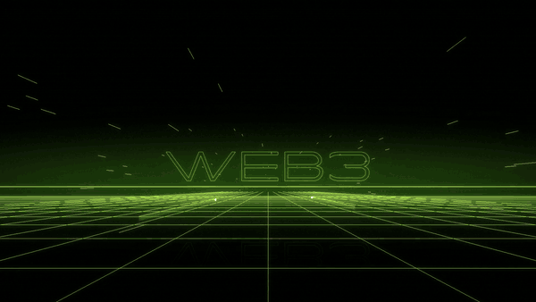
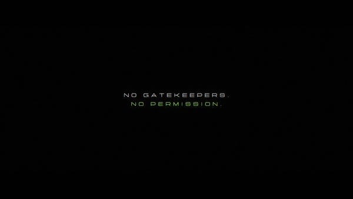
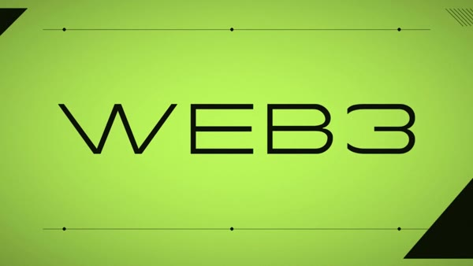
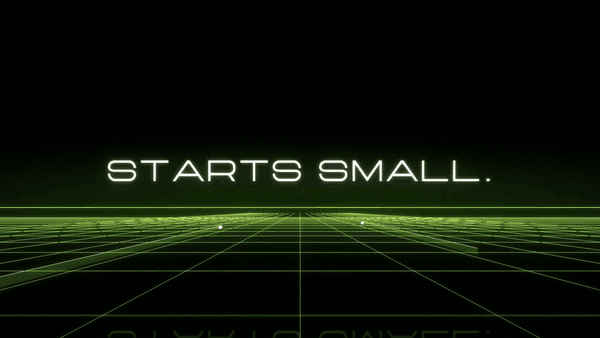
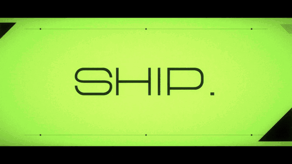
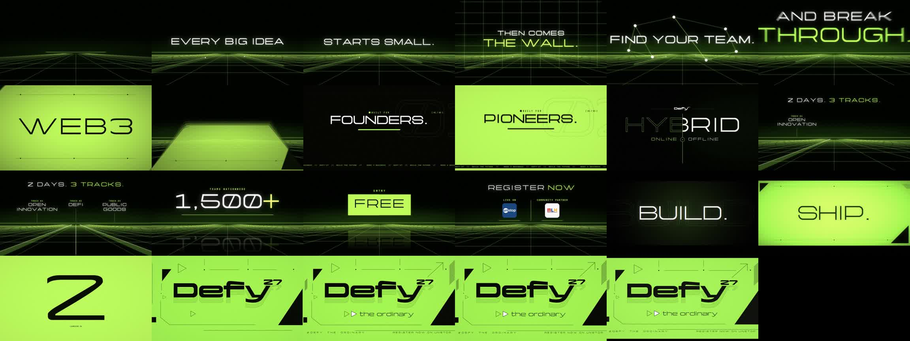

<div align="center">

# dropframe

### Every cut on the kick. Every drop on the frame.

**An agent skill that edits like a motion designer.**<br>
Give it your footage, your brand kit and a song. Get back a beat-synced, After-Effects-quality trailer, with sync you can measure and no AI look.<br><br>
<a href="https://zerko-sd.github.io/dropframe/"><b>Launch site</b></a> · <a href="#install"><b>Install</b></a> · <a href="#dropframe-vs-other-video-skills"><b>vs other skills</b></a>



<sub>The drop: a layered card, letters on separate depths, words swapping through space, on the downbeat to the frame.</sub>

</div>

---

## Why

Most AI video looks AI: floaty slow-motion, linear moves, cuts that sort of land near the beat, a stock *whoosh* on every transition.

dropframe follows the rules a real motion designer works by, and **checks them with numbers**:

- **Music-first.** It fits one exact beat grid to your song, finds which beats carry the kick, and only cuts on those.
- **Measured sync.** It reports the audio-vs-cut offset in milliseconds. Our reference trailer's drop lands **+0.9ms** from the beat.
- **A build-up made from your own track.** Filter sweep, 16th to 32nd stutter, half a beat of silence, then the drop. No stock SFX, ever.
- **After Effects motion.** Expo eases, real accumulation motion blur, momentum cuts, multiplane depth, cut-on-action.
- **One world, one flow.** A single visual system, so the trailer reads as one shot rather than clips stitched together.
- **Re-edits too.** Point it at an existing edit and a new song; it re-times, trims flash frames and rebuilds what doesn't fit.

## Before / after

<table>
<tr><th>Before: the original edit</th><th>After: dropframe</th></tr>
<tr><td></td><td></td></tr>
</table>

<div align="center">
 
<br><sub>Left: the build-up as one continuous camera move. Right: the countdown handing off to the end card.</sub>
<br><br>

<br><sub>The full 38s reference trailer (DeFy'27 hackathon), one frame every 1.7s.</sub>
</div>

## dropframe vs other video skills

| | **dropframe** | Template / composition video skills (e.g. [/brag](https://github.com/latent-spaces/brag)) |
|---|---|---|
| **Starts from** | Your footage, clips, Figma/brand assets, your song | Your codebase or a prompt, plus bundled music |
| **Music** | Beat grid detected; every cut on a strong kick; drop built from your track | A background bed chosen to fit the story |
| **Sync** | Measured: transient vs cut, in ms | Timed by the composer |
| **Sound** | Your song only, remixed (sweep, stutter, silence, drop) | Bundled SFX + optional narration |
| **Motion** | AE-grade: expo eases, motion blur, momentum cuts, multiplane depth | Web/CSS composition animation |
| **Re-editing** | Re-times and re-themes an existing edit scene by scene | Generates a new video |
| **Output** | MP4 + remixed WAV + cut/beat markers CSV for After Effects | MP4 + share copy |
| **Best for** | Trailers, reels, promos where the beat and the feel matter | Fast launch videos for a software project |

They're complementary: use a template skill for a quick product clip, and dropframe when the edit has to hit like a motion designer cut it.

## Install

**Any agent**, one command with the skills CLI (Claude Code, Cursor, Codex, Copilot, Gemini CLI, opencode and more):

```bash
npx skills add https://github.com/Zerko-sd/dropframe --skill dropframe
```

Add `-g` to install it globally (every project); leave it off to scope it to the current project.

**Claude Code** (plugin):

```
/plugin marketplace add Zerko-sd/dropframe
/plugin install dropframe@dropframe
```

**Codex**:

```bash
codex plugin marketplace add Zerko-sd/dropframe
codex plugin add dropframe@dropframe
```

To update later: `codex plugin marketplace upgrade dropframe`, then `codex plugin add dropframe@dropframe`.

<details><summary>No installer? Copy the skill directly.</summary>

```bash
git clone https://github.com/Zerko-sd/dropframe.git
cp -r dropframe/skills/dropframe ~/.claude/skills/      # or your agent's skill folder
```
</details>

**Requirements:** an agent that supports Agent Skills, **Python 3.10+**, **ffmpeg** on PATH, and:

```bash
pip install -r requirements.txt     # numpy, pillow, scipy, librosa
```

### Also works with

This repo exposes the skill at every agent's standard discovery path through symlinks, so no extra config is needed.

| Agent | How it discovers |
|---|---|
| Claude Code | `.claude/skills/dropframe/` (plus the `.claude-plugin/` marketplace install above) |
| Codex CLI | `.agents/skills/dropframe/`, walking up to the repo root |
| opencode | `.opencode/skills/dropframe/` at the project root |
| Google Antigravity | `.agents/skills/dropframe/`, or `~/.gemini/config/skills/dropframe/` globally |
| Other agents | Point custom instructions at `skills/dropframe/SKILL.md` (see [docs/other-agents.md](docs/other-agents.md)) |

> **Windows:** symlinks need `git config core.symlinks true` (or `git clone -c core.symlinks=true`) plus Developer Mode or admin rights. If they don't work on your system, copy `skills/dropframe/` into your agent's skill folder instead.

## Use it

Just ask:

> /dropframe make a 30s trailer for our hackathon from the clips in `./footage`, brand kit in `./brand`, song `track.mp3`, starting at 0:42

> /dropframe re-edit `promo_v3.mp4` onto this song, slower, cleaner, and make the drop hit harder

The skill plans the edit in beats, shows you the plan, checks changes on stills while you give notes, and **only renders when you say so**. Every render is a new version, verified before it's sent.

## The toolkit

You can run the scripts directly too (`skills/dropframe/scripts/`):

```bash
# 1. the song's grid: bpm, drift, kick pattern, weak beats, downbeat candidates
python3 beatgrid.py track.mp3 --out grid.json

# 2. a build-up + drop remixed from the track itself (drop snapped to the grid)
python3 remix.py track.mp3 --grid grid.json --drop-time 48.12 --bars-after 8 --out remix.wav

# 3. a complete 8-bar sequence to copy and re-word
DROPFRAME_FONT=./brand/Display.otf python3 example.py --audio remix.wav --out demo.mp4 \
  --lines "EVERY BIG IDEA" "STARTS SMALL." "FIND YOUR TEAM." "BREAK THROUGH." --drop WEB3 BUSINESS --final HACKATHON

# 4. prove it
python3 verify.py sync demo.mp4 --hits 10.667      # audio transient vs cut, in ms
python3 verify.py centre demo.mp4 --at 11.9:dark   # ink centring vs frame centre
python3 verify.py flashes demo.mp4                 # single-frame flash detection
```

`dfkit.py` is the motion kit everything is built on:

| | |
|---|---|
| **Eases** | `expo_out`, `expo_in`, `expo_io`, `cubic_io`, `back_out` |
| **World** | `world` (sky, horizon, grid floor flowing on global time), `place` (type plus floor reflection), `streak`, `bloom` |
| **Type** | `text_sprite` (ink-cropped), `glyph_layers` (per-letter, ink-centred) |
| **Cards** | `accent_card`: multiplane letters, decor, words swapping through depth |
| **Transitions** | `momentum_scale`, `horizon_switch`, `slant_wipe`, `shake`, `crt_off` |
| **Render** | `render`: accumulation motion blur (180-degree shutter) piped straight to ffmpeg |

## The rules it follows

<details><summary><b>Sync</b></summary>

- One uniform beat grid, drift-checked; the edit starts on a downbeat so beats are exact frames.
- Cut only on strong kicks, never the weak beat; big hits on bar downbeats.
- Cut on action: shots start ~3 frames into their animation, so the beat frame is already readable.
- Kick pulse on held shots; re-time baked-in animation to land on kicks.
- Measure it: if something feels late, check readability on the beat frame before blaming A/V offset.
</details>

<details><summary><b>Motion</b></summary>

- Nothing linear. Real motion blur. No frame-blended slow motion (that's the AI look).
- Momentum cuts: accelerate into the cut, arrive moving, settle on the beat.
- Shake and chroma split on 2-3 hits only. Zoom-through on the biggest.
- Switch worlds with the horizon-line collapse; end with a CRT power-off.
</details>

<details><summary><b>Design</b></summary>

- One world, one accent colour; solid accent cards only for big hits.
- Layered cards, never flat zooms of a picture.
- No HUD clutter, no brackets, copy that reads as a sentence.
- Logos crisp and never glowed; partner logos revealed together.
- Centre on ink, not font boxes; leave breathing room.
</details>

<details><summary><b>Workflow</b></summary>

- Plan in beats, preview on stills, render only on "go", version every render, verify before sending.
</details>

## FAQ

**Does it include music or fonts?** No. Bring a track you have the rights to and your brand fonts. The demo GIFs are silent.

**Do I need After Effects?** No. Everything renders in Python + ffmpeg. It also exports a markers CSV and the remixed WAV if you want to finish the edit in AE.

**Other resolutions or vertical video?** `dfkit` defaults to 1920x1080 @ 30fps; change `W`, `H` and `FPS` (e.g. 1080x1920 for Reels).

## What's in this repo

- `skills/dropframe/`: the skill (`SKILL.md`) and its toolkit (`scripts/`)
- `examples/hackathon-trailer/`: the beat map of the 38s reference trailer, as a template
- `docs/`: the launch site (GitHub Pages) and demo media
- `plugin.json`: portable Agent Plugins manifest
- `.claude-plugin/`: Claude Code manifest + marketplace catalog (also recognised by Codex)
- `.codex-plugin/`: Codex compatibility manifest
- `.claude/skills/dropframe/`, `.agents/skills/dropframe/`, `.opencode/skills/dropframe/`: symlinks to `skills/dropframe/` for discovery

## Contributing

Ideas, new transitions, new "worlds" and demo edits are welcome: open an issue or a PR. Share what you cut with dropframe and it may get featured here.

## Credits

- Reference trailer: DeFy'27 hackathon, VIT Chennai (The DAO Community x BIC)
- Audio analysis: [librosa](https://librosa.org) · rendering: [Pillow](https://python-pillow.org) + [FFmpeg](https://ffmpeg.org)

## Star History

[](https://star-history.com/#Zerko-sd/dropframe&Date)

## License

MIT. See [LICENSE](LICENSE). The reference trailer frames in `docs/` show the DeFy'27 hackathon brand and are included for demonstration only.

<div align="center"><br>If dropframe made your edit hit, a ⭐ helps other people find it.</div>
